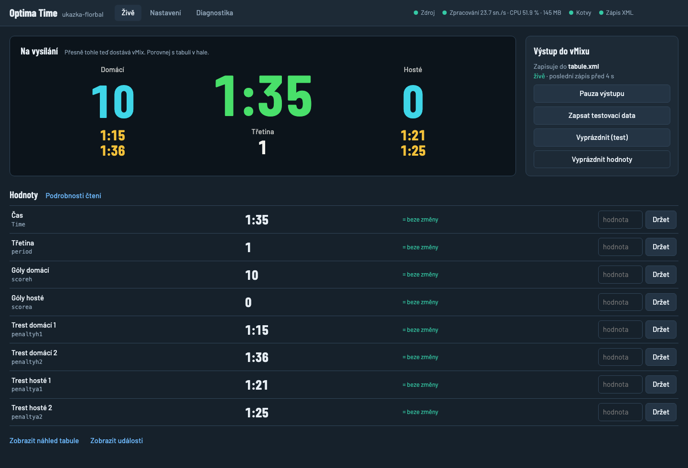

# Optima Time – návod pro obsluhu

Optima Time čte z kamery světelnou tabuli (čas, skóre, třetinu, tresty) a průběžně zapisuje hodnoty do XML souboru, který vMix čte jako Data Source. Grafika se tak mění sama.

**Zásada:** když si aplikace není jistá, drží poslední platnou hodnotu. Do vysílání nikdy nepošle nesmysl, nanejvýš hodnotu o chvíli později.

Aplikace má nahoře tři záložky:

| Záložka | Kdy |
|---|---|
| **Živě** | během zápasu. Nic se tu nedá nechtěně posunout. |
| **Nastavení** | jednou pro novou halu, kroky 1–5 |
| **Diagnostika** | při problému: vzorek, diagnostický balíček, log událostí |

Na horní liště je stav s čísly: **Zdroj** (běží / vypadl), **Čtení** (ms na snímek), **Kotvy** (shoda 0–1), **vMix** (doba zápisu XML). Zelená tečka znamená v pořádku. Při problému se nad obsahem objeví věta, co se děje a co udělat (část D). Vpravo nahoře je červené tlačítko **Pauza výstupu**. Levý panel ukazuje zdroj obrazu, cílový XML soubor, profil a počty snímků.

---

## A. Známá hala (1 minuta)

1. Spusť **Optima Time** (ikona na ploše). Otevře se okno aplikace a v oznamovací oblasti (vpravo dole) se objeví ikona. Zavřením okna se aplikace ukončí a grafika přestane dostávat hodnoty, proto se okno nejdřív zeptá. Na chvíli ho schovej raději minimalizací, zpátky ho vrátí ikona vpravo dole (**Otevřít Optima Time**).
2. Pokud je otevřený jiný profil: **Nastavení → 5. Profil a pokročilé → Načíst…** a vyber halu.
3. Na záložce **Živě** zkontroluj, že semafor je celý zelený a tabule **Na vysílání** ukazuje to samé co tabule v hale.

---

## B. Nová hala (do 10 minut)


### Před přenosem: kamera

- Pevný stativ, nic nesmí stínit výhled na tabuli.
- Co největší zoom, ale celá tabule v záběru.
- **Ruční expozice, raději tmavší obraz.** Svítící čísla nesmí být přepálená do bílé.
- Ruční ostření a frekvence 50 Hz (proti blikání LED).

### Jednou na PC: obraz z vMixu do aplikace

Capture kartu s kamerou drží vMix, proto aplikace bere obraz z vMixu přes **NDI**:

1. Ve vMixu: **Settings → Outputs / NDI / SRT**.
2. Nastav jeden z výstupů (Output 2/3/4) na vstup s tabulí (např. **KOM BOX**) a zapni u něj **NDI**. Případně použij volbu NDI pro jednotlivé vstupy, pokud ji tvoje verze má.

> Záložní cesta: virtuální kamera vMixu (**External** výstup → zařízení „vMix Video External 2“).

Nastavení je průvodce s pěti kroky. Kroky jsou nahoře, dají se přepínat i přímo, hotový krok má ✓. Dole vpravo je vždy **Pokračovat** na další krok.

### Nový profil

Na záložce **Nastavení** v kroku **5. Profil a pokročilé** klikni **Uložit jako nový…** a zadej název, např. `hala-ostrava-florbal`. Od teď se každá změna ukládá sama (vpravo nahoře „Uloženo“).

### 1. Zdroj obrazu

1. Zvol **NDI (např. vstup z vMixu)** → **Obnovit seznam** → vyber zdroj z vMixu (např. `PC (vMix - Output 2)`).
2. Do pár sekund se ukáže obraz a světlo **Zdroj** zezelená.
3. Vidíš-li na číslech „hřebeny“ (vodorovné roztřepení při změně), nastav **Odstranění prokladu** na „Prolnutí řádků“.

### 2. Rohy tabule

1. Přetáhni čtyři body **C1–C4** na **rohy tabule**: C1 levý horní, C2 pravý horní, C3 pravý dolní, C4 levý dolní. U každého je vidět jeho pozice v pixelech.
2. Při tažení se ukáže lupa. Na přesné doladění vyber roh vpravo v **Aktivní bod** (C1–C4) a posouvej ho tlačítky **− / +** u X a Y, nebo **šipkami** (se **Shiftem** po 10 px).
3. Vpravo dole je **narovnaná tabule**: musí být rovná a bez okolí. Pak **Pokračovat**.

### 3. Pole a kotvy

V tomto kroku je **narovnaná tabule**. Musí být rovná a bez okolí, jinak oprav rohy.

**Pole:** nejrychlejší je tlačítko **Přidat pole: florbal**. Vytvoří všech 8 polí (`Time`, `period`, `scoreh`, `scorea`, `penaltyh1`, `penaltyh2`, `penaltya1`, `penaltya2`) se správným typem a volbami. Obdélníky pak jen přetáhni na hodnoty na tabuli (kliknout, táhnout, za rohy změnit velikost). Jiné pole přidáš ručně:


1. Klikni **Přidat pole** a táhnutím nakresli obdélník kolem hodnoty.
   - Obdélník ať pokryje **všechny číslice i při nejdelší hodnotě** (např. `20:00`, skóre `10`).
   - Nech kolem trochu místa, ale ať v něm není nic jiného (nápisy, rámečky).
2. Vpravo v seznamu se objeví pole s tím, co aplikace právě čte. Klikni na něj a v editoru nastav:

| Na tabuli | Název v XML | Typ | Další volby |
|---|---|---|---|
| čas zápasu | `Time` | Čas | Desetiny v poslední minutě ✓, Tvar výstupu „Bez úvodní nuly (0:00)“ |
| skóre domácích | `scoreh` | Číslo (skóre) | |
| skóre hostů | `scorea` | Číslo (skóre) | |
| třetina | `period` | Třetina | |
| trest domácí 1, 2 | `penaltyh1`, `penaltyh2` | Čas | Prázdná hodnota „Vyprázdnit“, Tvar „Jak je na tabuli“ |
| trest hosté 1, 2 | `penaltya1`, `penaltya2` | Čas | Prázdná hodnota „Vyprázdnit“, Tvar „Jak je na tabuli“ |

**Názvy v XML musí sedět s tím, co je namapované ve vMixu.** Rozlišují se velká a malá písmena (`Time` není `time`). Zkontroluje to krok 4 (**Kontrola názvů podle vMixu**).

**Kotvy (důležité):** kotva je **nápis, který se na tabuli nikdy nemění**, např. `PERIÓDA`, `DOMÁCI`, `HOSTIA`. Podle kotev aplikace pozná, že video stěna ukazuje něco jiného (animace gólu, reklama). Pak nic nečte a drží hodnoty.

1. Jakmile jsou nakreslená pole, aplikace **navrhne kotvy sama**. Najde nápisy, které se během posledních ~12 s neměnily (oranžové čárkované rámečky). Znovu je navrhne tlačítko **Najít kotvy automaticky**. Spouštěj ho, když tabule ukazuje běžné skóre, ne animaci.
2. **Zkontroluj je a uprav:** kliknutím kotvu vybereš, tažením posuneš, za bílé rohy změníš velikost, šipkami doladíš (se Shiftem po 10 px). Vzor kotvy se po úpravě sám sejme znovu. Špatnou kotvu vyber (na obrázku nebo vpravo v seznamu **Pole a kotvy**) a smaž (**Smazat kotvu N** pod obrázkem), chybějící přidej (**Přidat kotvu** a táhnutím označ nápis).
3. Nad obrázkem se ukáže „Kotva: sedí“ a v seznamu vpravo u kotev čísla blízko 1. **Kotvy** na horní liště zezelenají.

Stejně se upravují i **pole**: kliknutím vybrat, tažením posunout, za rohy zvětšit, šipkami doladit.

### 4. Výstup pro vMix

1. Zadej **Cestu k XML souboru**, např. `C:\vmix-data\tabule.xml`.
   - Pokud měníš stávající aplikaci, použij **novou cestu**. Starý soubor nech, dokud není ověřený souběžný provoz.
2. Ve **vMixu** (jednou pro titulek):
   1. **Data Sources** → **+** → **XML** → vyber soubor (nebo adresu `http://127.0.0.1:8787/data/values.xml`).
   2. **XPath:** `/root`, interval obnovy (Auto Refresh / Update every) **100 ms**.
   3. V titulku přiřaď polím titulku sloupce `Time`, `scoreh`, `scorea`, `period`, `penaltyh1` …
   4. Pole titulku napojené na Data Source se nesmí zároveň měnit jinak (ručně, jiným zdrojem).
3. **Zkouška:** vpravo klikni **Zapsat testovací data** (je i na záložce Živě v **Rychlých zásazích**). Titulek ve vMixu ukáže náhodné hodnoty. Pak **Zpět na živé hodnoty**.

4. **Kontrola názvů:** v kartě **Kontrola názvů podle vMixu** klikni **Vybrat XML soubor…** a vyber XML, které vMix používá teď (třeba ze stávající aplikace). Aplikace ukáže, které názvy sedí, které se liší jen velikostí písmen (jedním klikem je přejmenuješ) a které chybí.

### 5. Profil a pokročilé

**Připraveno k přenosu:** seznam nahoře musí být celý zelený (zdroj, pole, čtení, kotvy, zápis XML, test vMixu, živý výstup). U chybějícího bodu je napsané, co udělat. Pak klikni **Zamknout nastavení**.


Rozbalovací **Pokročilé nastavení** použij jen při problému:

- **Otočení obrazu:** kamera je natočená o 90°.
- **Slévání snímků:** tabule ve videu bliká (číslice občas zmizí). „Maximum“ s 2–3 snímky. Přidá zpoždění.
- **Práh shody kotev:** kotvy hlásí „lost“, i když tabule ukazuje skóre. Snížit třeba na 0,7.

U pole je v editoru pod **Pokročilé**: směr počítání času, zarovnání mezerami (aby text v grafice neposkakoval), prahy čtení a názvy period (např. `1=1. tretina; 4=predĺženie`).

### Zámek nastavení

**Zamknout nastavení** (krok 5 nebo na záložce Živě v Rychlých zásazích) zamkne nastavení na zápas. Nic se nedá posunout ani smazat, ani z jiného zařízení. Ruční hodnoty, pauza a test výstupu fungují dál. Nastavení pak ukazuje jen náhled a seznam Připraveno k přenosu. **Odemknout nastavení** se zeptá, jestli opravdu. Zámek platí do restartu aplikace.

### Před přenosem

Na záložce **Diagnostika** nahraj krátký vzorek (**Nahrát vzorek 60 s**). Hodí se pro pozdější ladění.

---

## C. Během přenosu (záložka Živě)



**Na vysílání** ukazuje přesně to, co teď dostává vMix, rozložené jako tabule v hale. Porovnávej ji pohledem s tabulí.

| Situace | Co udělat |
|---|---|
| Hodnota je špatně nebo se nečte | Vpravo v **Stav polí** klikni na pole, napiš správnou hodnotu a klikni **Držet**. (U času stačí **Držet ručně** vedle času.) Grafika ukazuje tvou hodnotu (na tabuli Na vysílání v čárkovaném rámečku), dokud neklikneš **Uvolnit**. |
| Grafika se nemá hýbat | **Pauza výstupu** (vpravo nahoře nebo v Rychlých zásazích). Grafika drží poslední hodnoty. Pak **Obnovit výstup**. |
| Vyčistit hodnoty (po zápase) | **Vyprázdnit hodnoty** (ruční hodnoty zůstanou). |
| Gól, animace na stěně | Nic, aplikace to pozná podle kotev a hodnoty drží. |
| Někdo projde před kamerou | Nic. Hodnoty se drží a po chvíli se čtou dál. |
| Chceš vidět, co kamera vidí | **Náhled kamery** dole. Když překáží, **Skrýt**. |
| Chceš vidět, co se dělo | **Poslední události** dole, celý log s filtrem a hledáním na záložce Diagnostika. |

Stavy u hodnot:

| Stav | Význam |
|---|---|
| ✓ nová | hodnota se právě změnila |
| = beze změny | čte se stejná hodnota |
| … čeká na potvrzení | nová hodnota se ověřuje (neočekávaná změna se potvrzuje 0,4–3 s) |
| ! zamítnuto | čtení nebylo jisté; drží se poslední hodnota |
| ∅ prázdné | pole nesvítí (např. trest neběží) |
| ⌛ zastaralé | tabule teď není vidět (animace, výpadek); drží se poslední hodnota |
| ✋ drženo ručně | platí ruční hodnota |

---

## D. Když svítí žlutá nebo červená

Aplikace se ozve i mimo své okno: když zdroj nebo zápis XML nefunguje déle než 3 s, zpracování se zasekne, nebo tabule ukazuje přes minutu něco jiného, Windows ukážou oznámení a zazní varovný zvuk. Když se to spraví, přijde ještě oznámení „… zpět“. Vše je i v událostech.


| Hláška | Co udělat |
|---|---|
| Zdroj obrazu vypadl | Zkontroluj ve vMixu NDI výstup, kabel ke kameře, síť. Aplikace se připojuje sama znovu. |
| Zpracování nestíhá | Zavři náročné programy na PC s vMixem. |
| Tabule ukazuje něco jiného | Během animace normální. Když trvá dlouho, zkontroluj kotvy (nehýbe se kamera?). |
| Zápis XML selhává nebo je pomalý | Soubor má otevřený jiný program (Excel, antivir). Zkus jinou složku, nebo ve vMixu HTTP adresu. |
| Výstup je pozastavený / testovací data | Na záložce Živě klikni **Obnovit výstup** / **Zpět na živé hodnoty**. |
| Zpracování se zaseklo | Restartuj aplikaci (ikona v oznamovací oblasti → Ukončit, pak znovu spustit). Hodnoty v souboru zůstanou a po startu se navážou. |

Při jakémkoli problému: **Diagnostika → Diagnostický balíček (ZIP)** a pošli ho. Obsahuje snímek, výřezy, profil a logy.

Na Diagnostice jsou dál: doba zpracování snímku, zahozené snímky, rozptyl příchodu snímků a procesor; **výřezy polí** (původní i binarizované, tak jak je čte OCR); graf **stability kotev** (čárkovaná čára je práh, pod ním se nečte); log událostí s filtrem (Změny hodnot, Kotvy a zdroj, Výstrahy) a hledáním. Kliknutím na událost se zobrazí celý záznam.


---

## E. Spouštění z příkazové řádky

```text
optima-time run --profile hala-ostrava-florbal                 # profil podle jména
optima-time run --profile hala-ostrava --no-browser --port 8788  # druhá instance vedle první
optima-time run --profile hala --host 0.0.0.0 --pin 4821        # přístup z tabletu v síti, jen s PINem
optima-time --self-test                                         # kontrola instalace
```

Profily, logy a vzorky jsou v `%APPDATA%\OptimaTime\` (`profiles\`, `logs\`, `samples\`).
