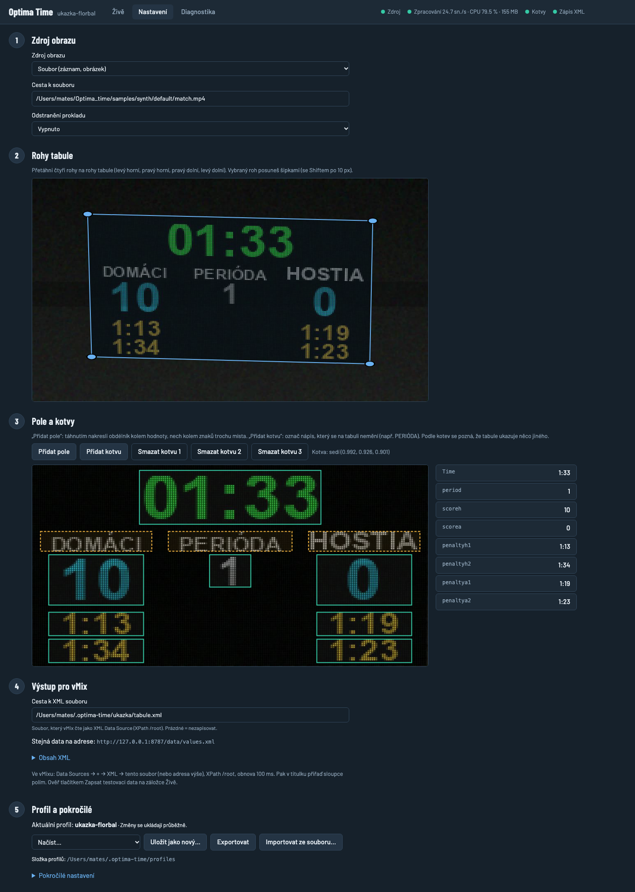
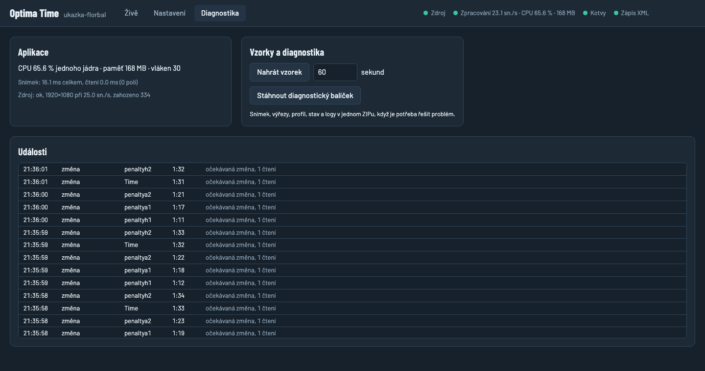

# Optima Time – návod pro obsluhu

Optima Time čte z kamery světelnou tabuli (čas, skóre, třetinu, tresty) a průběžně zapisuje hodnoty do XML souboru, který vMix čte jako Data Source. Grafika se tak mění sama.

**Zásada:** když si aplikace není jistá, drží poslední platnou hodnotu. Do vysílání nikdy nepošle nesmysl, nanejvýš hodnotu o chvíli později.

Aplikace má nahoře tři záložky:

| Záložka | Kdy |
|---|---|
| **Živě** | během zápasu. Nic se tu nedá nechtěně posunout. |
| **Nastavení** | jednou pro novou halu, kroky 1–5 |
| **Diagnostika** | při problému: vzorek, diagnostický balíček, log událostí |

Vpravo nahoře je semafor: **Zdroj, Zpracování, Kotvy, Zápis XML**. Zelená znamená v pořádku. Při problému se pod lištou objeví věta, co se děje a co udělat (část D).

---

## A. Známá hala (1 minuta)

1. Spusť **Optima Time** (ikona na ploše). Otevře se prohlížeč s aplikací a v oznamovací oblasti (vpravo dole) se objeví ikona.
2. Pokud je otevřený jiný profil: **Nastavení → 5. Profil a pokročilé → Načíst…** a vyber halu.
3. Na záložce **Živě** zkontroluj, že semafor je celý zelený a tabule **Na vysílání** ukazuje to samé co tabule v hale.

---

## B. Nová hala (do 10 minut)



### Před přenosem: kamera

- Pevný stativ, nic nesmí stínit výhled na tabuli.
- Co největší zoom, ale celá tabule v záběru.
- **Ruční expozice, raději tmavší obraz.** Svítící čísla nesmí být přepálená do bílé.
- Ruční ostření a frekvence 50 Hz (proti blikání LED).

### Jednou na PC: obraz z vMixu do aplikace

Capture kartu s kamerou drží vMix, proto aplikace bere obraz z vMixu přes **NDI**:

1. Ve vMixu: **Settings → Outputs / NDI / SRT**.
2. Nastav jeden z výstupů (Output 2/3/4) na vstup s tabulí (např. **KOM BOX**) a zapni u něj **NDI**. Případně použij volbu NDI pro jednotlivé vstupy, pokud ji tvoje verze má.

> Záložní cesta: virtuální kamera vMixu (**External** výstup → zařízení „vMix Video External 2“).

### Nový profil

Na záložce **Nastavení** v kroku **5. Profil a pokročilé** klikni **Uložit jako nový…** a zadej název, např. `hala-ostrava-florbal`. Od teď se každá změna ukládá sama (vpravo nahoře „Uloženo“).

### 1. Zdroj obrazu

1. Zvol **NDI (např. vstup z vMixu)** → **Obnovit seznam** → vyber zdroj z vMixu (např. `PC (vMix - Output 2)`).
2. Do pár sekund se ukáže obraz a světlo **Zdroj** zezelená.
3. Vidíš-li na číslech „hřebeny“ (vodorovné roztřepení při změně), nastav **Odstranění prokladu** na „Prolnutí řádků“.

### 2. Rohy tabule

1. Přetáhni čtyři modré body na **rohy tabule**: levý horní, pravý horní, pravý dolní, levý dolní.
2. Při tažení se ukáže lupa. Na přesné doladění klikni na roh (zoranžoví) a posouvej **šipkami**, se **Shiftem** po 10 px.

### 3. Pole a kotvy

V tomto kroku je **narovnaná tabule**. Musí být rovná a bez okolí, jinak oprav rohy.

**Pole:** pro každou hodnotu na tabuli:

1. Klikni **Přidat pole** a táhnutím nakresli obdélník kolem hodnoty.
   - Obdélník ať pokryje **všechny číslice i při nejdelší hodnotě** (např. `20:00`, skóre `10`).
   - Nech kolem trochu místa, ale ať v něm není nic jiného (nápisy, rámečky).
2. Vpravo v seznamu se objeví pole s tím, co aplikace právě čte. Klikni na něj a v editoru nastav:

| Na tabuli | Název v XML | Typ | Další volby |
|---|---|---|---|
| čas zápasu | `Time` | Čas | Desetiny v poslední minutě ✓, Tvar výstupu „Bez úvodní nuly (0:00)“ |
| skóre domácích | `scoreh` | Číslo (skóre) | |
| skóre hostů | `scorea` | Číslo (skóre) | |
| třetina | `period` | Třetina | |
| trest domácí 1, 2 | `penaltyh1`, `penaltyh2` | Čas | Prázdná hodnota „Vyprázdnit“, Tvar „Jak je na tabuli“ |
| trest hosté 1, 2 | `penaltya1`, `penaltya2` | Čas | Prázdná hodnota „Vyprázdnit“, Tvar „Jak je na tabuli“ |

**Názvy v XML musí sedět s tím, co je namapované ve vMixu.** Rozlišují se velká a malá písmena (`Time` není `time`).

**Kotvy (důležité):** kotva je **nápis, který se na tabuli nikdy nemění**, např. `PERIÓDA`, `DOMÁCI`, `HOSTIA`. Podle kotev aplikace pozná, že video stěna ukazuje něco jiného (animace gólu, reklama). Pak nic nečte a drží hodnoty.

1. Klikni **Přidat kotvu** a táhnutím označ nápis. Přidej 2–3 kotvy na různých místech tabule.
2. Vedle tlačítek se ukáže „Kotva: sedí“ a čísla blízko 1. Světlo **Kotvy** zezelená.

### 4. Výstup pro vMix

1. Zadej **Cestu k XML souboru**, např. `C:\vmix-data\tabule.xml`.
   - Pokud měníš stávající aplikaci, použij **novou cestu**. Starý soubor nech, dokud není ověřený souběžný provoz.
2. Ve **vMixu** (jednou pro titulek):
   1. **Data Sources** → **+** → **XML** → vyber soubor (nebo adresu `http://127.0.0.1:8787/data/values.xml`).
   2. **XPath:** `/root`, interval obnovy (Auto Refresh / Update every) **100 ms**.
   3. V titulku přiřaď polím titulku sloupce `Time`, `scoreh`, `scorea`, `period`, `penaltyh1` …
   4. Pole titulku napojené na Data Source se nesmí zároveň měnit jinak (ručně, jiným zdrojem).
3. **Zkouška:** na záložce **Živě** klikni **Zapsat testovací data**. Titulek ve vMixu ukáže náhodné hodnoty. Pak **Zpět na živé hodnoty**.

### 5. Profil a pokročilé

Rozbalovací **Pokročilé nastavení** použij jen při problému:

- **Otočení obrazu:** kamera je natočená o 90°.
- **Slévání snímků:** tabule ve videu bliká (číslice občas zmizí). „Maximum“ s 2–3 snímky. Přidá zpoždění.
- **Práh shody kotev:** kotvy hlásí „lost“, i když tabule ukazuje skóre. Snížit třeba na 0,7.

U pole je v editoru pod **Pokročilé**: směr počítání času, zarovnání mezerami (aby text v grafice neposkakoval), prahy čtení a názvy period (např. `1=1. tretina; 4=predĺženie`).

### Před přenosem

Na záložce **Diagnostika** nahraj krátký vzorek (**Nahrát vzorek**, 60 s). Hodí se pro pozdější ladění.

---

## C. Během přenosu (záložka Živě)


**Na vysílání** ukazuje přesně to, co teď dostává vMix, rozložené jako tabule v hale. Porovnávej ji pohledem s tabulí.

| Situace | Co udělat |
|---|---|
| Hodnota je špatně nebo se nečte | V řádku pole napiš správnou hodnotu a klikni **Držet**. Grafika ukazuje tvou hodnotu (na tabuli Na vysílání v čárkovaném rámečku), dokud neklikneš **Uvolnit**. |
| Grafika se nemá hýbat | **Pauza výstupu**. Grafika drží poslední hodnoty. Pak **Obnovit výstup**. |
| Vyčistit hodnoty (po zápase) | **Vyprázdnit hodnoty** (ruční hodnoty zůstanou). |
| Gól, animace na stěně | Nic, aplikace to pozná podle kotev a hodnoty drží. |
| Někdo projde před kamerou | Nic. Hodnoty se drží a po chvíli se čtou dál. |
| Chceš vidět, co kamera vidí | **Zobrazit náhled tabule** pod hodnotami. |
| Chceš vidět, co se dělo | **Zobrazit události**. |

Stavy u hodnot:

| Stav | Význam |
|---|---|
| ✓ nová | hodnota se právě změnila |
| = beze změny | čte se stejná hodnota |
| … čeká na potvrzení | nová hodnota se ověřuje (neočekávaná změna se potvrzuje 0,4–3 s) |
| ! zamítnuto | čtení nebylo jisté; drží se poslední hodnota |
| ∅ prázdné | pole nesvítí (např. trest neběží) |
| ⌛ zastaralé | tabule teď není vidět (animace, výpadek); drží se poslední hodnota |
| ✋ drženo ručně | platí ruční hodnota |

---

## D. Když svítí žlutá nebo červená

| Hláška | Co udělat |
|---|---|
| Zdroj obrazu vypadl | Zkontroluj ve vMixu NDI výstup, kabel ke kameře, síť. Aplikace se připojuje sama znovu. |
| Zpracování nestíhá | Zavři náročné programy na PC s vMixem. |
| Tabule ukazuje něco jiného | Během animace normální. Když trvá dlouho, zkontroluj kotvy (nehýbe se kamera?). |
| Zápis XML selhává nebo je pomalý | Soubor má otevřený jiný program (Excel, antivir). Zkus jinou složku, nebo ve vMixu HTTP adresu. |
| Výstup je pozastavený / testovací data | Na záložce Živě klikni **Obnovit výstup** / **Zpět na živé hodnoty**. |
| Zpracování se zaseklo | Restartuj aplikaci (ikona v oznamovací oblasti → Ukončit, pak znovu spustit). Hodnoty v souboru zůstanou a po startu se navážou. |

Při jakémkoli problému: **Diagnostika → Stáhnout diagnostický balíček** a pošli ho. Obsahuje snímek, výřezy, profil a logy.



---

## E. Spouštění z příkazové řádky

```text
optima-time run --profile hala-ostrava-florbal                 # profil podle jména
optima-time run --profile hala-ostrava --no-browser --port 8788  # druhá instance vedle první
optima-time run --profile hala --host 0.0.0.0 --pin 4821        # přístup z tabletu v síti, jen s PINem
optima-time --self-test                                         # kontrola instalace
```

Profily, logy a vzorky jsou v `%APPDATA%\OptimaTime\` (`profiles\`, `logs\`, `samples\`).
